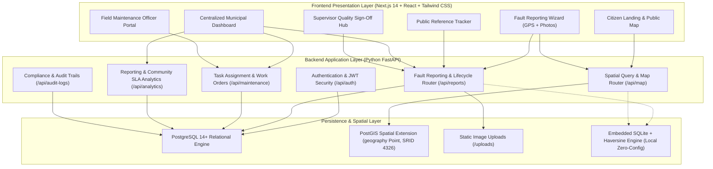
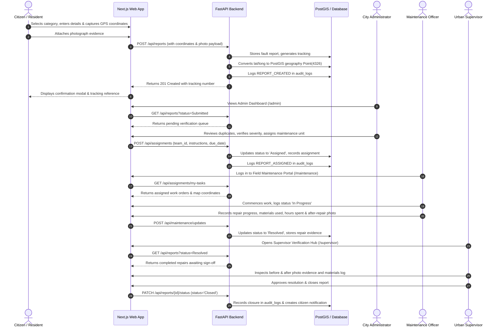
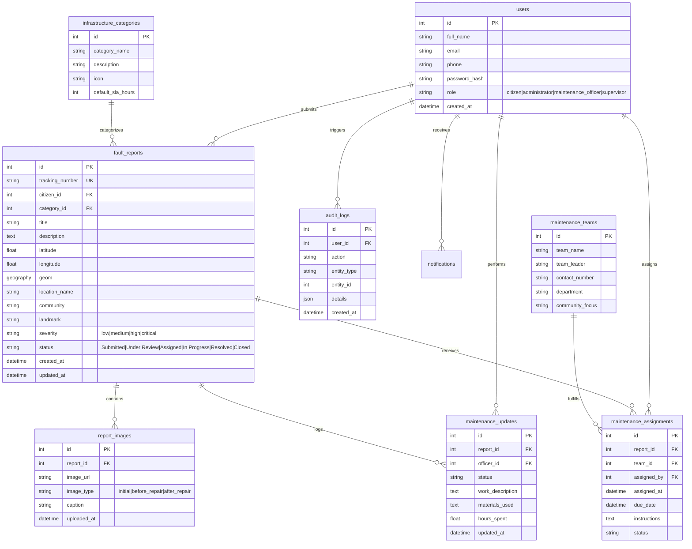

# FIMMS - System Architecture Specification
## Location-Aware Public Infrastructure Fault Reporting and Maintenance Tracking System
### Case Study: Western Area Urban, Freetown, Sierra Leone

---

## 1. Executive Overview

The **Freetown Infrastructure Monitoring and Maintenance System (FIMMS)** is a specialized location-aware municipal incident management platform designed for the unique urban landscape of Freetown's Western Area Urban.

The primary goal of the Minimum Viable Product (MVP) is to establish a closed-loop incident lifecycle:
$$\text{Citizen Report} \longrightarrow \text{GPS Location} \longrightarrow \text{Admin Triage} \longrightarrow \text{Field Dispatch} \longrightarrow \text{Repair Execution} \longrightarrow \text{Supervisor Closure}$$

---

## 2. High-Level Architecture Diagram

---

## 3. End-to-End Fault Lifecycle Sequence

---

## 4. Entity-Relationship (ER) Schema

---

## 5. Western Area Urban Geographical Coverage

The pilot application covers the following primary commercial and residential zones:
1. **Central Freetown** (8.4840° N, -13.2340° W) — Historical Cotton Tree, Siaka Stevens Street, Central Business District, Kroo Town Road.
2. **Congo Cross** (8.4825° N, -13.2570° W) — Roundabout transit hub, Main Motor Road, St. Edwards Secondary School.
3. **Kissy** (8.4789° N, -13.2120° W) — Kissy Road, Shell New Road, Eastern industrial & residential thoroughfares.
4. **Lumley** (8.4712° N, -13.2758° W) — Lumley Beach Road, Lumley Police Station, Juba Bridge connection.
5. **Wilkinson Road** (8.4750° N, -13.2640° W) — Western arterial commercial strip, banking hubs, Murray Town Junction.

### Spatial Distance Querying
The backend natively queries spatial geometry using PostGIS `ST_DWithin` and `ST_Distance`. When running on embedded SQLite, custom Python C-level bindings calculate great-circle distance via the Haversine formula:
$$d = 2R \arcsin \left( \sqrt{\sin^2\left(\frac{\Delta \phi}{2}\right) + \cos(\phi_1)\cos(\phi_2)\sin^2\left(\frac{\Delta \lambda}{2}\right)} \right)$$
where $R = 6371\text{ km}$.
